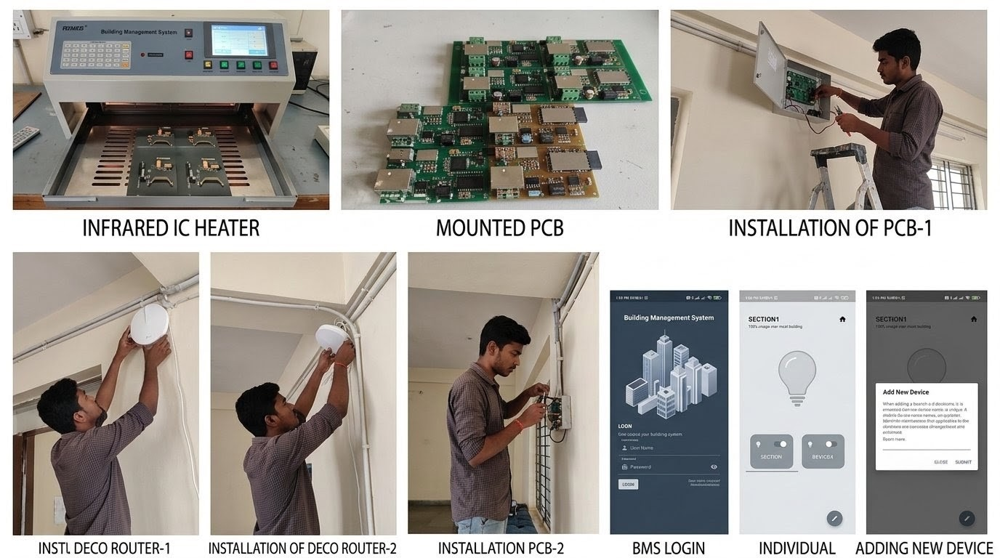

# BMS – Building & Light Management System

## Project Overview
## Project Gallery

---

An academic project focused on creating a sustainable and efficient educational environment through a Building and Light Management System.

The project was presented through a practical demonstration. I had the opportunity to explore the system, observe its components, understand its working principles and operate the setup.

## Technologies and Concepts Covered

- Internet of Things (IoT)
- ESP32-WROOM Microcontroller
- Embedded Systems and RTOS
- PCB Design and Fabrication
- Wi-Fi Connectivity
- Firebase
- WebSocket Applications
- MQTT Communication
- HTTP, HTTPS and REST APIs
- Light Management System (LMS)

## Hardware Components Explored

- ESP32-WROOM
- BP2525
- RT9193
- MB6F-GKD
- S9014 Transistor
- BT131S
- Relays
- MOC3021

## My Role and Learning Experience

- Attended a practical demonstration of the Building and Light Management System.
- Explored the hardware components and their functions.
- Observed the system architecture and communication methods.
- Had access to operate the setup and understand its functionality.
- Learned about IoT-based building automation and smart lighting.

## Key Learning Outcomes

- IoT-based Building Automation
- ESP32 Hardware Fundamentals
- Embedded Systems
- PCB Components and Functionality
- Wireless Communication
- Smart Lighting Management

## Project Details

| Category | Details |
|---|---|
| Project | Building & Light Management System |
| Domain | IoT and Embedded Systems |
| Platform | ESP32-WROOM |
| Project Type | Practical Demonstration and Learning |
| Application | Building and Light Management |

---

**Note:** This repository contains project documentation and photographs. It does not contain source code.
